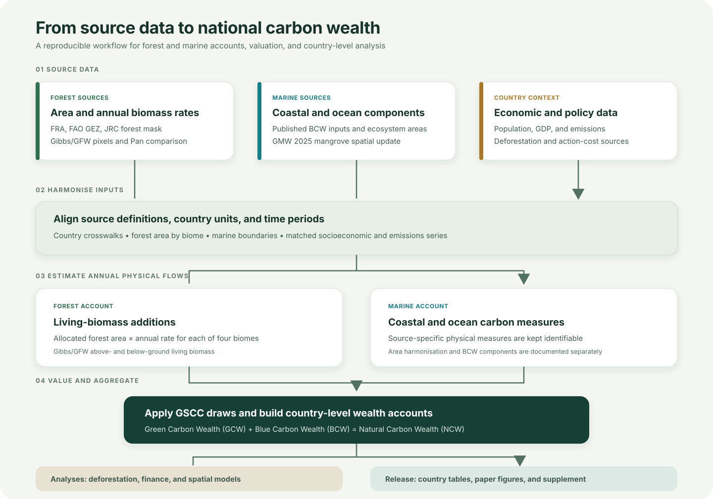

# Forest and ocean carbon sinks underpin national wealth

<p align="center">
  
  
  
  
  <a href="LICENSE"></a>
  <a href="LICENSE-CC-BY-4.0.md"></a>
</p>

**Research code, source data, derived accounts, and analysis outputs for the national natural carbon wealth study.**

Associated manuscript: *Forest and ocean carbon sinks underpin national wealth as deforestation may concentrate burdens in poorer countries*.

Authors: Nathalie Hilmi, Maria-Sophia Chondrou, Loua Aurel De Vince Vehi, Ibrahim Issifu, and Fabio Berzaghi.

This repository rebuilds country-level forest and marine carbon accounts and combines them into **Natural Carbon Wealth** (NCW). It also contains analyses of forest capacity loss, climate-finance scenarios, and spatial relationships.



*Repository workflow. Source-specific physical measures and assumptions remain documented separately.*

## Study accounts

- **Forest account.** Annual carbon additions to above- and below-ground living forest biomass are estimated using Gibbs/GFW gross-removal pixels for 2001-2023. Four non-mangrove mean rates are calculated for the tropical, subtropical, temperate, and boreal FAO GEZ domains and applied to FRA 2025 forest area allocated by biome. This measure does not include forest soils, deadwood, or the net ecosystem carbon balance.
- **Marine account.** Published Blue Carbon Wealth (BCW) components are combined with a spatial update of mangrove area from Global Mangrove Watch 2025. The update changes mangrove area; the other BCW components and source-specific rates are retained.
- **National account.** Green Carbon Wealth (GCW) and Blue Carbon Wealth (BCW) are combined as Natural Carbon Wealth (NCW). The primary uncertainty draws propagate the GSCC draws. Spatial variation in Gibbs/GFW pixels is reported as a separate sensitivity, not as a confidence interval for the biome rates.
- **Complementary analyses.** FAOSTAT forest flux, deforestation-related capacity loss, Ibrahim and Busch climate-finance scenarios, and spatial model sequences are retained as separately documented analyses.

See [`docs/METHODS.md`](docs/METHODS.md), [`docs/DATA_SOURCES.md`](docs/DATA_SOURCES.md), and [`docs/DATA_AUDIT.md`](docs/DATA_AUDIT.md) for definitions, sources, and checks.

## Repository map

```text
.
├── data/
│   ├── raw/
│   │   ├── environmental/forest/  FRA, GEZ, Gibbs/GFW, JRC, FAOSTAT, Pan
│   │   ├── environmental/marine/  BCW and Global Mangrove Watch
│   │   ├── economic/              emissions, population, GDP, action-cost data
│   │   └── geospatial/            country and EEZ boundaries
│   ├── reference/                 transcribed values and crosswalks
│   ├── metadata/                  source registry and raw-file checksums
│   ├── derived/                   reusable intermediate tables
│   └── logs/                      source-processing logs
├── code/
│   ├── src/gcw/                   reusable calculation and validation modules
│   ├── scripts/                   pipeline, rebuild, audit, and analysis entry points
│   ├── notebooks/                 figures, analysis, and manuscript-output notebooks
│   └── tests/                     pipeline unit tests
├── results/
│   ├── country_level_gcw.csv      country and territory forest account
│   ├── country_level_ncw.csv      combined country-level account
│   ├── tables/                    paper and supplementary tables
│   ├── figures/paper_v2/          current paper figure set
│   └── validation/                checks, inventories, and analysis diagnostics
├── docs/                          methods, data provenance, and results guides
├── .github/                       automated tests and repository workflows
├── CITATION.cff                   repository citation metadata
├── LICENSE                        MIT licence for code
└── LICENSE-CC-BY-4.0.md           CC BY 4.0 terms for project data and documentation
```

### Where to start

| Task | Main entry point | Main output or guide |
| --- | --- | --- |
| Rebuild the full country accounts | [`code/scripts/main.py`](code/scripts/main.py) | `results/country_level_gcw.csv`, `results/country_level_ncw.csv` |
| Recalculate Gibbs/GFW biome rates | [`code/scripts/build_gfw_rates.py`](code/scripts/build_gfw_rates.py) | `data/derived/gfw_gibbs_biome_rates_non_mangrove.csv` |
| Inspect the forest calculation | `code/src/gcw/forest_areas.py`, `biome_shares.py`, `gfw_rates.py`, `forest_uptake_gfw.py` | `data/derived/` |
| Rebuild account tables and checks | `code/src/gcw/gcw.py`, `ncw.py`, `tables.py`, `checks.py` | `results/` |
| Reproduce the spatial sequence | [`code/scripts/run_spatial_full_sequence_2026_10_19.py`](code/scripts/run_spatial_full_sequence_2026_10_19.py) | `docs/SPATIAL_MODEL_SELECTION_EVIDENCE_2026-10-20.md` |
| Run the 2024 emissions extension | [`code/scripts/run_spatial_emissions_extension_2026_10_20.py`](code/scripts/run_spatial_emissions_extension_2026_10_20.py) | `results/validation/` |
| Compare climate-finance approaches | [`code/scripts/compare_finance_and_action_costs_2026_10_19.py`](code/scripts/compare_finance_and_action_costs_2026_10_19.py) | `docs/FINANCE_APPROACH_COMPARISON_2026-10-19.md` |
| Find the full results inventory | `results/validation/RESULTS_INVENTORY_2026-10-20.txt` | Detailed measures, comparisons, and diagnostics |

The reusable calculation modules in `code/src/gcw/` are the source of truth. Scripts call those modules. Notebooks are used for analysis and figures, not as hidden replacements for the pipeline.

## Reproduce the project

### Local installation

Python 3.11 or newer is required.

```bash
git clone https://github.com/aurvl/ncw.git
cd ncw
python -m venv .venv
```

Activate the environment, then install and run the checks:

```bash
# macOS or Linux
source .venv/bin/activate

# Windows PowerShell
# .\.venv\Scripts\Activate.ps1

python -m pip install -e ".[dev,spatial]"
python -m pytest -q
```

For a quick rebuild using the committed four-biome Gibbs/GFW rate table and cached biome allocation, run:

```bash
python code/scripts/main.py --reuse-gfw-rates
```

To recompute the Gibbs/GFW rates from the published tiles, run `python code/scripts/build_gfw_rates.py --forest-type-dir data/raw/environmental/forest/gfw_gibbs_2025/forest_type`, then run `python code/scripts/main.py --reuse-gfw-rates`. This uses the non-mangrove rate table just produced, without processing the tiles a second time. Add `--rasters` to the second command to recompute the GEZ x country x JRC forest-mask allocation as well. Without `--rasters`, the pipeline uses the cached allocation in `data/derived/`.

### Large source files

The 272 Gibbs/GFW gross-removal GeoTIFF tiles and 272 matching forest-type tiles are large downloads and are not stored in Git. The rate-building workflow downloads and verifies them with `code/scripts/download_gfw_dataverse.py` and `code/scripts/download_gfw_forest_types.py`. The compressed gross-removal set is about 37 GB; the forest-type set is about 9 GB. Place them under:

```text
data/raw/environmental/forest/gfw_gibbs_2025/gross_removals/
data/raw/environmental/forest/gfw_gibbs_2025/forest_type/
```

Then use `python code/scripts/build_gfw_rates.py --forest-type-dir data/raw/environmental/forest/gfw_gibbs_2025/forest_type --workers 2`. Increase the worker count only when memory permits. The GMW polygon archive is also large and is excluded from Git; download, checksum, and overlay instructions are in [`docs/GMW_GCW_VALUATION_AND_ABATEMENT_SCENARIOS.md`](docs/GMW_GCW_VALUATION_AND_ABATEMENT_SCENARIOS.md).

To verify files that are present locally, run `python code/scripts/checksum_raw_sources.py --raw data/raw --output raw_checksums_local.csv`, then compare its SHA-256 values with `data/metadata/raw_checksums.csv`. Raw input files remain unchanged; see [`docs/DATA_SOURCES.md`](docs/DATA_SOURCES.md) for source-specific licences and citations.

## Results and manuscript material

| Path | Contents |
| --- | --- |
| `results/country_level_gcw.csv` | Forest account by accounting unit |
| `results/country_level_ncw.csv` | Combined forest and marine account by unit |
| `results/tables/manuscript/` | Main-text and supplementary tables |
| `results/figures/paper_v2/` | Current paper figures |
| `results/validation/country_level_results_master_2026-10-20.csv` | Consolidated country-level analysis table |
| `results/validation/RESULTS_INVENTORY_2026-10-20.txt` | Full inventory of generated findings and diagnostics |

The validation folder also contains intermediate audits and local rendering checks. Those files are not all manuscript outputs. The current paragraph-by-paragraph Results plan is [`docs/RESULTS_REWRITE_PLAN_2026-10-19.md`](docs/RESULTS_REWRITE_PLAN_2026-10-19.md).

## Data, licensing, and citation

- Code: MIT, see [`LICENSE`](LICENSE).
- Project-produced data and documentation: CC BY 4.0, see [`LICENSE-CC-BY-4.0.md`](LICENSE-CC-BY-4.0.md).
- Source datasets retain their own licences and citation requirements. See [`docs/DATA_SOURCES.md`](docs/DATA_SOURCES.md).
- Repository citation metadata: [`CITATION.cff`](CITATION.cff).

Please cite the associated manuscript when using its research results, and cite the original data sources listed in the data documentation.
