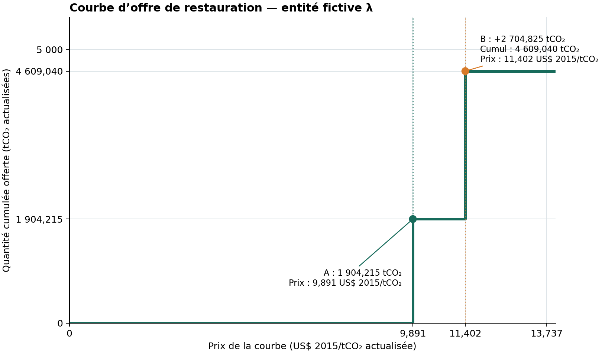

# Exemple fictif des calculs de la section 9.2

Ce document déroule un exemple simplifié pour rendre lisibles les calculs de la section 9.2 de [PIPELINE_FR.md](PIPELINE_FR.md). Les équations et coefficients fixes sont ceux de la section 9.2.

L'exemple suit deux cellules d'un même pays fictif et reprend, dans le même ordre, les étapes de la section 9.2 : carbone par hectare (9.2.1–9.2.2), coûts et choix de méthode (9.2.3), filtres, quantités et courbe d'offre (9.2.4), puis cible et coûts associés (9.2.5). Les sous-sections ci-dessous séparent les opérations numériques pour qu'on puisse les suivre une à une.

## 1. Données fictives de départ

Chaque ligne du tableau représente une cellule fictive, c’est-à-dire une zone de la carte de Busch à laquelle sont associés une surface et des paramètres. A et B sont des exemples construits; elles ne correspondent pas à deux emplacements réels de la carte. Elles ont les mêmes paramètres biologiques, mais diffèrent par leur surface, le coût de régénération naturelle et les données disponibles sur le reboisement qui aurait lieu sans projet.

| Paramètre                       |                    Cellule A |  Cellule B | Unité ou règle                                                               |
| ------------------------------- | ---------------------------: | ---------: | ---------------------------------------------------------------------------- |
| Surface `area_m2`               |                      100 000 |    150 000 | m²                                                                           |
| Surface $a_c=area\_m2/10\,000$  |                           10 |         15 | ha                                                                           |
| $A_{c,NR}$, $k_{c,NR}$          |                     80; 0,12 |   80; 0,12 | tC/ha; an$^{-1}$                                                             |
| $r_c^{NR}$                      |                         0,25 |       0,25 | rapport racines/parties aériennes                                            |
| $A_{c,P}$, $k_{c,P}$            |                    100; 0,12 |  100; 0,12 | tC/ha; an$^{-1}$                                                             |
| $r_c^P$                         |                         0,30 |       0,30 | rapport racines/parties aériennes                                            |
| $w_i$                           |                         0,40 |       0,40 | part du carbone récolté stockée dans les produits bois à longue durée de vie |
| $nr\_cost$                      |                        1 000 |      3 000 | US$ 2020/ha                                                                  |
| $np\_cost$                      |                          800 |        800 | US$ 2020/ha                                                                  |
| $ep\_cost$                      |                        1 200 |      1 200 | US$ 2020/ha                                                                  |
| $e_i$                           |                         0,25 |       0,25 | part exotique des plantations                                                |
| $crop\_va$                      |                          100 |        100 | US$ 2020/ha/an                                                               |
| $p_i$                           |                           20 |         20 | US$ 2020/tC récoltée                                                         |
| Masque général $G_c$            |                            1 |          1 | cellule admissible                                                           |
| Tampons $B_{c,NR}$ et $B_{c,P}$ |                       1 et 1 |     1 et 1 | les deux méthodes passent le tampon                                          |
| Variables $bau$                 | 0,20 pour les trois périodes | manquantes | Cellule B utilisera la valeur de remplacement 0,0571795                      |

Dans cet exemple, $G_c=1$ et les deux valeurs $B_{c,NR}=B_{c,P}=1$ sont fixées pour les cellules A et B : elles ne résultent pas d’un test sur des coordonnées réelles. Dans les données de Busch et al., le filtre général $G_c$ écarte notamment les déserts, les forêts déjà existantes, les zones de haute altitude, les prairies naturelles et les terres cultivées. Le tampon $B_{c,NR}$ vaut 1 si la cellule se trouve à moins de 5 km d’une forêt naturelle existante, qui peut fournir des graines; le tampon $B_{c,P}$ vaut 1 si elle se trouve à moins de 40 km d’une plantation existante. A et B passent donc les trois filtres par construction, afin que l’exemple puisse comparer les coûts des deux méthodes. Si un tampon vaut 0, la méthode correspondante n’est pas disponible dans cette cellule ([Busch et al., 2024](https://doi.org/10.1038/s41558-024-02068-1)).

La perte annuelle de capacité forestière utilisée pour la cible est fixée fictivement à $L_i=250\ \mathrm{tCO_2/an}$. Elle est supposée constante pendant les 30 années du calcul de comparaison.

## 2. Période étudiée et pondération temporelle

L’exemple suit la croissance et les coûts pendant les 30 années qui suivent le début de la restauration : c’est la période étudiée. Les quantités produites chaque année sont additionnées pour obtenir un cumul sur cette période. Avant l’addition, chaque année $t$ reçoit le coefficient de pondération temporelle $d_t=0{,}95^{t-1}$. Il vaut 1 en année 1, puis diminue de 5 % par an; les valeurs des années futures comptent donc moins dans le cumul. Ce coefficient ne décrit ni le poids des arbres ni une baisse biologique de leur croissance. Les premiers coefficients sont :

| Année $t$ | Calcul | $d_t$ |
|---:|---|---:|
| 1 | $0{,}95^0$ | 1,0000 |
| 2 | $0{,}95^1$ | 0,9500 |
| 3 | $0{,}95^2$ | 0,9025 |
| 10 | $0{,}95^9$ | 0,6302 |
| 20 | $0{,}95^{19}$ | 0,3774 |
| 30 | $0{,}95^{29}$ | 0,2259 |

La somme des poids sur les 30 années est une série géométrique :

$$
D_{30}=\sum_{t=1}^{30}0{,}95^{t-1}
=\frac{1-0{,}95^{30}}{1-0{,}95}
=15{,}707225.
$$

Cette somme sert notamment au cumul des additions annuelles au sol et au calcul du coût d'opportunité cumulé.

## 3. Carbone cumulé par hectare en régénération naturelle

Pour la régénération naturelle, le stock aérien théorique à l'âge $a$ est :

$$
S_{c,NR}(a)=80\left(1-e^{-0{,}12a}\right)^2.
$$

À l'âge zéro, $S_{c,NR}(0)=0$. $S_{c,NR}(t)$ est le stock aérien vivant à l'âge $t$; l'addition de l'année $t$ est la différence entre ce stock et celui de l'année précédente, $\Delta S_t=S(t)-S(t-1)$. On multiplie ensuite cette addition par $d_t$ pour la pondérer dans le cumul sur les 30 ans. Les premières années se calculent ainsi :

| Âge $t$ | Stock $S_{c,NR}(t)$ (tC/ha) | Addition $\Delta S_t=S(t)-S(t-1)$ (tC/ha) | Poids $d_t$ | Addition pondérée $d_t\Delta S_t$ (tC/ha) |
|---:|---:|---:|---:|---:|
| 1 | 1,022959 | 1,022959 | 1,0000 | 1,022959 |
| 2 | 3,642214 | 2,619255 | 0,9500 | 2,488292 |
| 3 | 7,311968 | 3,669755 | 0,9025 | 3,311954 |

Par exemple, pour l'année 2 : 
- $\Delta S_2=3{,}642214-1{,}022959=2{,}619255$, 
- puis $d_2\Delta S_2=0{,}95\times2{,}619255=2{,}488292\ \mathrm{tC/ha}$.

En répétant ce calcul pour les 30 années, on obtient :

$$
C_{c,\mathrm{aérien}}^{NR}
=\sum_{t=1}^{30}d_t\left[S_{c,NR}(t)-S_{c,NR}(t-1)\right]
=46{,}716971\ \mathrm{tC/ha}.
$$

Le terme racinaire estime le carbone sous terre à partir du carbone aérien cumulé. Le rapport racines/parties aériennes fictif est $r_c^{NR}=0{,}25$ : le carbone racinaire vaut donc 25 % du cumul aérien.

$$
C_{c,\mathrm{racines}}^{NR}
=0{,}25\times46{,}716971
=11{,}679243\ \mathrm{tC/ha}.
$$

Le modèle ajoute aussi au sol un taux fixe de $0{,}415107735\ \mathrm{tC/ha/an}$. Comme cet apport annuel se répète pendant toute la période, on le multiplie par la somme des coefficients $D_{30}$ pour obtenir son cumul pondéré :

$$
C_{c,\mathrm{sol}}^{NR}
=0{,}415107735\times D_{30}
=0{,}415107735\times15{,}707225
=6{,}520190\ \mathrm{tC/ha}.
$$

Le carbone cumulé par hectare en régénération naturelle est la somme des trois réservoirs calculés (biomasse aérienne, racines et sol) :

$$
C_{c,NR}^{*}
=46{,}716971+11{,}679243+6{,}520190
=64{,}916404\ \mathrm{tC/ha}.
$$

## 4. Carbone cumulé par hectare en plantation

### 4.1 Détermination de la rotation

Pour la plantation, le stock aérien théorique est :

$$
S_{c,P}(a)=100\left(1-e^{-0{,}12a}\right)^2.
$$

Dans cet exemple, les cellules A et B ont les mêmes paramètres de plantation : $A_{c,P}=100\ \mathrm{tC/ha}$ est le stock aérien théorique maximal et $k_{c,P}=0{,}12\ \mathrm{an}^{-1}$ règle la vitesse à laquelle il est approché. $S_{c,P}(a)$ désigne le stock aérien vivant d’un hectare à l’âge $a$. La fonction donne $S_{c,P}(8)=38{,}082119$, $S_{c,P}(9)=43{,}613407$ et $S_{c,P}(10)=48{,}832953\ \mathrm{tC/ha}$.

La croissance relative $g_{c,a}$ mesure l'augmentation du stock entre les âges $a-1$ et $a$, rapportée au stock de l'âge précédent :

$$
g_{c,a}=\frac{S_{c,P}(a)-S_{c,P}(a-1)}{S_{c,P}(a-1)}.
$$

C’est le taux de hausse du stock aérien entre deux âges successifs, sans unité; multiplié par 100, il s’exprime en pourcentage. Le critère de rotation compare cette hausse à un seuil calculé avec un taux d’actualisation annuel de 5 %. On examine les âges de 2 à 29 ans et on retient le dernier âge qui satisfait le seuil. À l’âge 9 :

$$
g_{c,9}=\frac{43{,}613407-38{,}082119}{38{,}082119}=0{,}145246
>\frac{0{,}05}{1-1{,}05^{-9}}=0{,}140690.
$$

Ainsi, le stock augmente de $14{,}5246\ \%$ entre les âges 8 et 9, au-dessus du seuil de $14{,}0690\ \%$ : le critère est satisfait. À l'âge 10, la croissance relative est calculée entre les stocks des âges 9 et 10 :

$$
g_{c,10}=\frac{48{,}832953-43{,}613407}{43{,}613407}=0{,}119678
<\frac{0{,}05}{1-1{,}05^{-10}}=0{,}129505.
$$

La hausse du stock est alors de $11{,}9678\ \%$, sous le seuil de $12{,}9505\ \%$ : le critère n'est plus satisfait.

Le dernier âge candidat est donc $a=9$ et la rotation vaut $H_c=a+1=10$ ans. Les récoltes ont lieu aux années $t=10$, 20 et 30.

### 4.2 Composantes de carbone en plantation

Les trois premières additions aériennes pondérées sont calculées comme en régénération naturelle :

| Année $t$ | Addition aérienne $S(t)-S(t-1)$ (tC/ha) | Poids $d_t$ | Addition pondérée (tC/ha) |
|---:|---:|---:|---:|
| 1 | 1,278699 | 1,0000 | 1,278699 |
| 2 | 3,274068 | 0,9500 | 3,110365 |
| 3 | 4,587193 | 0,9025 | 4,139942 |

À la fin de l'année 10, les arbres de la première rotation sont récoltés et la nouvelle rotation repart à l'âge zéro. Le stock vivant après la coupe est donc $S_{c,P}(0)=0$, tandis qu'avant la coupe il était $S_{c,P}(9)=43{,}613407\ \mathrm{tC/ha}$. La variation de stock de cette année est la différence « après la coupe moins avant la coupe »; elle est négative parce que le carbone aérien est prélevé. Le coefficient $d_{10}=0{,}630249$ pondère cette variation de l'année 10 dans le cumul sur 30 ans :

$$
d_{10}\left[S_{c,P}(0)-S_{c,P}(9)\right]
=0{,}630249\times(0-43{,}613407)
=-27{,}487324\ \mathrm{tC/ha}.
$$

Cette valeur n’est pas reprise seule dans les calculs suivants. Elle est l’un des 30 termes de la somme du carbone aérien vivant. Elle retranche du stock vivant le carbone coupé; le carbone récolté est suivi séparément, et seule la part $w_i$ restant dans les produits bois à longue durée de vie est ajoutée ensuite.

$$
C_{c,\mathrm{aérien}}^P
=\sum_{t=1}^{30}d_t\left[S_{c,P}(t\bmod H_c)-S_{c,P}((t-1)\bmod H_c)\right]
=13{,}949607\ \mathrm{tC/ha}.
$$

C’est ce cumul, et non la seule variation de l’année 10, qui sert ensuite à calculer le carbone racinaire et le carbone total de la plantation. Le terme racinaire vaut :

$$
C_{c,\mathrm{racines}}^P
=0{,}30\times13{,}949607
=4{,}184882\ \mathrm{tC/ha}.
$$

Le sol est compté avant la première récolte, donc pour $t=1,\ldots,9$. La somme des neuf poids vaut $\sum_{t=1}^{9}d_t=7{,}395012$ :

$$
C_{c,\mathrm{sol}}^P
=0{,}092749069\times7{,}395012
=0{,}685880\ \mathrm{tC/ha}.
$$

Le carbone aérien prélevé aux trois récoltes, après pondération par l'année de chaque récolte, est :

| Année de récolte $t$ | Stock $S_{c,P}(t)$ (tC/ha) | Poids $d_t$ | $d_tS_{c,P}(t)$ (tC/ha) |
|---:|---:|---:|---:|
| 10 | 48,832953 | 0,630249 | 30,776940 |
| 20 | 82,679384 | 0,377354 | 31,199363 |
| 30 | 94,609914 | 0,225936 | 21,375742 |
| **Total** |  |  | **83,352045** |

La part qui reste dans les produits bois est $w_i=0{,}40$ :

$$
w_iC_{c,\mathrm{récolté}}^P
=0{,}40\times83{,}352045
=33{,}340818\ \mathrm{tC/ha}.
$$

Le cumul total de plantation par hectare est alors :

$$
C_{c,P}^{*}
=13{,}949607+4{,}184882+0{,}685880+33{,}340818
=52{,}161188\ \mathrm{tC/ha}.
$$

## 5. Coûts et choix de méthode dans chaque cellule

Avant de comparer les méthodes, on exprime tous les montants dans la même monnaie, puis on calcule le coût net de chaque méthode sur 30 ans. Les valeurs fictives du tableau de départ sont en dollars 2020. Elles sont converties une seule fois en dollars 2015 avec le facteur de 9.2.3 :

$$
f_{20\rightarrow15}=\frac{237{,}017}{258{,}811}=0{,}915791833,
\qquad x^{2015}=f_{20\rightarrow15}x^{2020}.
$$

Les paramètres monétaires fictifs après conversion sont calculés comme suit :

$$
\begin{aligned}
nr\_cost^{2015}&=1\,000\times f_{20\rightarrow15}=915{,}791833\ \text{US\$ 2015/ha},\\
np\_cost^{2015}&=800\times f_{20\rightarrow15}=732{,}633466\ \text{US\$ 2015/ha},\\
ep\_cost^{2015}&=1\,200\times f_{20\rightarrow15}=1\,098{,}950199\ \text{US\$ 2015/ha},\\
crop\_va^{2015}&=100\times f_{20\rightarrow15}=91{,}579183\ \text{US\$ 2015/(ha·an)},\\
p_i^{2015}&=20\times f_{20\rightarrow15}=18{,}315837\ \text{US\$ 2015/tC}.
\end{aligned}
$$

La part exotique $e_i$ représente la proportion des plantations de l’entité constituée d’espèces d’arbres exotiques (non indigènes). Sa valeur fictive est ici $0{,}25$; dans cet exemple, aucun genre ne déclenche une règle de coût particulière. Le coût moyen retenu associe donc 25 % du coût de plantation exotique et 75 % du coût de plantation native. Le coût initial de plantation par hectare est donc :

$$
E_{c,P}^{(0)}
=0{,}25\times1\,098{,}950199+0{,}75\times732{,}633466
=824{,}212649\ \text{US\$\ 2015/ha}.
$$

$E_{c,P}^{(0)}$ désigne ce coût de départ par hectare. À chaque récolte, le calcul applique la règle de replantation de 9.2.3 : il multiplie le coût déjà cumulé par $1+d_t$. Avec $H_c=10$, les récoltes ont lieu aux années 10, 20 et 30 :

$$
\begin{aligned}
E_{c,P}^{(10)}&=824{,}212649(1+0{,}630249410)=1\,343{,}672185,\\
E_{c,P}^{(20)}&=1\,343{,}672185(1+0{,}377353603)=1\,850{,}711725,\\
E_{c,P}^{(30)}&=1\,850{,}711725(1+0{,}225935541)=2\,268{,}853280.
\end{aligned}
$$

$E_{c,P}^{(30)}$, noté aussi $E_{c,P}$, est donc le coût cumulé de plantation par hectare à la fin des 30 ans. Après prise en compte des récoltes aux années 10, 20 et 30 selon la règle de replantation du modèle, le coût de plantation atteint $2\,268{,}85\ \text{US\$\ 2015/ha}$ sur 30 ans. Ce montant entre dans $K_{c,P}$, avec le coût d’opportunité du terrain et la recette nette du bois, pour obtenir le coût net de la cellule en plantation.

Le coût d’opportunité du terrain est commun aux deux méthodes. On l’obtient en additionnant son coût annuel pondéré par les 30 coefficients :

$$
crop\_va^{2015}D_{30}
=91{,}579183\times15{,}707225
=1\,438{,}455\ \text{US\$\ 2015/ha}.
$$

Pour la plantation, on retranche aussi la recette nette du bois. La quantité récoltée pondérée $C_{c,\mathrm{récolté}}^P=83{,}352045\ \mathrm{tC/ha}$ a été calculée à la section 4.2 :

$$
p_i^{2015}C_{c,\mathrm{récolté}}^P
=18{,}315837\times83{,}352045
=1\,526{,}662\ \text{US\$\ 2015/ha}.
$$

Pour la cellule A, le coût net par hectare est $915{,}792+1\,438{,}455=2\,354{,}247\ \text{US\$\ 2015/ha}$ en régénération naturelle, et $2\,268{,}853+1\,438{,}455-1\,526{,}662=2\,180{,}646\ \text{US\$\ 2015/ha}$ en plantation. Pour obtenir le coût total d’une cellule, on multiplie le coût par hectare par sa surface $a_c$. La méthode est ensuite choisie en comparant, pour chaque option, le carbone par hectare au coût net par hectare; le tableau donne les calculs numériques et les rapports obtenus pour chaque cellule.

$B_{c,m}=1$ si la méthode passe le critère de faisabilité et 0 sinon. Les coûts par hectare et les rapports de chaque cellule sont :

| Cellule et méthode | Carbone cumulé pondéré sur 30 ans $C_{c,m}^{*}$ (tC/ha) | Calcul du coût total $K_{c,m}$ (US\$ 2015/cellule) |            Rapport $R_{c,m}$ (tC/US\$ 2015) | Méthode retenue |
| ------------------ | ------------------------------------------------------: | -------------------------------------------------: | ------------------------------------------: | --------------- |
| A, NR              |                                               64,916404 |            $10\times2\,354{,}246644=23\,542{,}466$ | $64{,}916404/(23\,542{,}466/10)=0{,}027574$ | NR              |
| A, P               |                                               52,161188 |            $10\times2\,180{,}645650=21\,806{,}457$ | $52{,}161188/(21\,806{,}457/10)=0{,}023920$ |                 |
| B, NR              |                                               64,916404 |            $15\times4\,185{,}830309=62\,787{,}455$ | $64{,}916404/(62\,787{,}455/15)=0{,}015509$ |                 |
| B, P               |                                               52,161188 |            $15\times2\,180{,}645650=32\,709{,}685$ | $52{,}161188/(32\,709{,}685/15)=0{,}023920$ | P               |

Le rapport $R_{c,m}$ indique le nombre de tonnes de carbone obtenues par dollar de coût net : plus il est élevé, plus la méthode fournit de carbone par dollar dépensé.

Pour A, la plantation coûte moins cher au total (21 806 US\$ contre 23 542 US\$), mais son cumul de carbone est aussi plus faible (52,16 contre 64,92 tC/ha). La régénération naturelle fournit donc davantage de carbone par dollar ($0{,}027574$ contre $0{,}023920$ tC/US\$) et est retenue.

Pour B, la régénération naturelle produit également davantage de carbone (64,92 contre 52,16 tC/ha), mais son coût total est beaucoup plus élevé (62 787 US\$ contre 32 710 US\$). Cette hausse de coût dépasse le gain de carbone : la plantation fournit davantage de carbone par dollar ($0{,}023920$ contre $0{,}015509$ tC/US\$) et est retenue. Le modèle choisit ainsi la méthode la plus efficace en carbone par dollar dans chaque cellule; il ne choisit pas simplement le coût total le plus faible. Ici, les coûts nets sont positifs.

## 6. Filtres, additionnalité et quantité offerte

On vérifie ensuite si chaque cellule peut contribuer à l’offre. Dans cet exemple, les valeurs $G_c=1$ et $B_{c,m_c^*}=1$ ont été fixées pour les deux cellules : aucune méthode n’est donc écartée par ces filtres. La quantité offerte est ensuite réduite à la part qui n’aurait pas été reboisée sans projet.

Pour la cellule A, les trois valeurs $bau$ sont égales à 0,20 :

$$
BAU_A
=0{,}510928\times0{,}20+0{,}305911\times0{,}20+0{,}183161\times0{,}20
=0{,}20.
$$

$BAU_c$ est la part du reboisement qui aurait eu lieu même sans projet; la part attribuée au projet est son complément $1-BAU_c$. La cellule A a donc une part additionnelle de 0,80. Pour la cellule B, les trois entrées $bau$ manquent : le modèle utilise sa valeur de remplacement $BAU_B=0{,}0571795$, d’où une part additionnelle de 0,9428205.

La quantité de la cellule A utilise le cumul NR et sa surface de 10 ha :

$$
\begin{aligned}
q_{iA}^{*}
&=10\times64{,}916404\times1\times1\times0{,}80\times\frac{44}{12}\\
&=1\,904{,}215\ \mathrm{tCO_2\ actualisées}.
\end{aligned}
$$

La quantité de la cellule B utilise le cumul de plantation et sa surface de 15 ha :

$$
\begin{aligned}
q_{iB}^{*}
&=15\times52{,}161188\times1\times1\times0{,}9428205\times\frac{44}{12}\\
&=2\,704{,}825\ \mathrm{tCO_2\ actualisées}.
\end{aligned}
$$

Ces quantités sont des cumuls pondérés sur 30 ans, pas des flux annuels. Leur somme, $4\,609{,}040\ \mathrm{tCO_2}$, est l’offre totale des deux cellules dans l’exemple.

## 7. Prix des cellules et courbe d'offre

Le prix de courbe est le coût net de la cellule divisé par son carbone théorique total, avant les filtres et l’additionnalité. Il sert à placer la cellule sur l’axe des prix; les filtres et l’additionnalité réduisent ensuite la quantité offerte, pas ce prix. Les coûts de cette illustration sont en dollars 2015.

Pour la cellule A :

$$
p_{iA}^{\mathrm{courbe}}
=\frac{23\,542{,}466}{(44/12)\times10\times64{,}916404}
=\frac{23\,542{,}466}{2\,380{,}268}
=9{,}891\ \text{US\$ 2015/tCO}_2\text{ actualisée}.
$$

Pour la cellule B :

$$
p_{iB}^{\mathrm{courbe}}
=\frac{32\,709{,}685}{(44/12)\times15\times52{,}161188}
=\frac{32\,709{,}685}{2\,868{,}865}
=11{,}402\ \text{US\$ 2015/tCO}_2\text{ actualisée}.
$$

Les seuils de départ sont espacés de 5 US\$ 2020/tCO$_2$; ils sont convertis en US\$ 2015 avec le même facteur. Ainsi, 10 et 15 US\$ 2020 correspondent à 9,158 et 13,737 US\$ 2015. Aucun prix de cellule n’atteint le premier seuil; les deux prix sont sous le second :

$$
V_i(9{,}158)=0,
\qquad
V_i(13{,}737)=q_{iA}^{*}+q_{iB}^{*}=4\,609{,}040\ \mathrm{tCO_2\ actualisées}.
$$

Les deux cellules entrent donc dans la courbe entre ces seuils convertis. Le saut correspond au pas de 5 US\$ 2020 utilisé pour construire la grille des prix.

La figure ci-dessous montre la quantité cumulée offerte en fonction du prix de courbe.

## 8. Cible de perte et mobilisation partielle d'une cellule

La capacité annuelle perdue fictive est $L_i=250\ \mathrm{tCO_2/an}$. Pour la comparer à une offre cumulée sur 30 ans, l’exemple suppose que cette capacité annuelle perdue reste constante pendant toute la période, puis lui applique les mêmes coefficients $d_t$. La quantité cible est donc :

$$
Q_i^{\mathrm{cible}}
=L_iD_{30}
=250\times15{,}707225
=3\,926{,}806\ \mathrm{tCO_2\ actualisées}.
$$

Pour estimer le coût d’atteinte, on classe les cellules par leur coût net rapporté à la quantité réellement offerte après filtres et additionnalité. C’est le coût effectif par tonne $\widetilde p_{ic}=K_{c,m_c^*}/q_{ic}^{*}$ :

$$
\widetilde p_{iA}=\frac{23\,542{,}466}{1\,904{,}215}=12{,}363,
\qquad
\widetilde p_{iB}=\frac{32\,709{,}685}{2\,704{,}825}=12{,}093
\quad[\text{US\$ 2015/tCO}_2\text{ actualisée}].
$$

La cellule B a le coût effectif par tonne le plus faible; elle est donc mobilisée en premier et fournit $2\,704{,}825$ tCO$_2$ actualisées. Il reste à fournir :

$$
3\,926{,}806-2\,704{,}825=1\,221{,}981\ \mathrm{tCO_2\ actualisées}.
$$

La cellule A peut fournir $1\,904,215$ tCO$_2$ actualisées; seule la fraction nécessaire pour compléter la cible est retenue :

$$
\alpha_{iA}
=\frac{1\,221{,}981}{1\,904{,}215}=0{,}641724.
$$

Ainsi, $\alpha_{iB}=1$ signifie que B est utilisée entièrement et $\alpha_{iA}=0{,}641724$ que 64,1724 % de A est mobilisée. L’offre retenue atteint la cible à l’arrondi près.

## 9. Trois coûts pour atteindre la cible

### Coût net

Le coût net additionne le coût de chaque cellule selon sa fraction mobilisée $\alpha$; un éventuel coût négatif resterait dans la somme. Ici, B est mobilisée entièrement et 64,1724 % de A :

$$
\begin{aligned}
K_i^{\mathrm{net}}
&=1\times32\,709{,}684750+0{,}6417242801\times23\,542{,}466440\\
&=47\,817{,}457\ \text{US\$\ 2015}.
\end{aligned}
$$

### Somme des coûts positifs

Cette mesure remplace chaque coût négatif éventuel par zéro avant de faire la somme. Comme les deux coûts sont positifs, elle donne ici le même résultat que le coût net :

$$
K_i^{+}
=1\times\max(32\,709{,}684750,0)+0{,}6417242801\times\max(23\,542{,}466440,0)
=47\,817{,}457\ \text{US\$\ 2015}.
$$

### Paiement uniforme au prix marginal

La dernière cellule mobilisée est A; son coût effectif par tonne est le prix marginal, $\widetilde p_{i,\mathrm{marg}}=12{,}363344706\ \text{US\$ 2015/tCO}_2$. Le scénario uniforme applique ce même prix à toutes les tonnes de la cible, y compris celles fournies par B :

$$
K_i^{\mathrm{uniform}}
=\max(12{,}363344706,0)\times3\,926{,}806
=48\,548{,}456\ \text{US\$\ 2015}.
$$

Dans cet exemple, le paiement uniforme dépasse le coût net de 730,999 US\$ 2015, car le prix de la dernière cellule mobilisée est appliqué à toutes les tonnes, y compris celles fournies à moindre coût par B. C'est un scénario de paiement défini par le modèle, pas une dépense observée.

## 10. Équivalent annuel des coûts en US\$ 2015

Les coûts sont déjà exprimés en dollars 2015. Leur équivalent annuel constant s’obtient en divisant chaque valeur actualisée par la somme des poids sur 30 ans, $D_{30}$. Ce montant est un équivalent mathématique, pas un calendrier réel de dépenses :

$$
K_i^{x,\mathrm{annuel,2015}}
=\frac{K_i^{x,\mathrm{PV,2015}}}{D_{30}}
=\frac{K_i^{x,\mathrm{PV,2015}}}{15{,}707225},
\qquad x\in\{\mathrm{net},+,\mathrm{uniform}\}.
$$

| Mesure | Coût actualisé (US\$ 2015) | Équivalent annuel (US\$ 2015/an) |
|---|---:|---:|
| Coût net | 47 817,457 | 3 044,297 |
| Somme des coûts positifs | 47 817,457 | 3 044,297 |
| Paiement uniforme | 48 548,456 | 3 090,836 |

>*Les chiffres de ce document servent uniquement à suivre les calculs à la main. Ils ne sont pas des résultats du projet, ni une reproduction des courbes calculées à partir des données réelles.*
